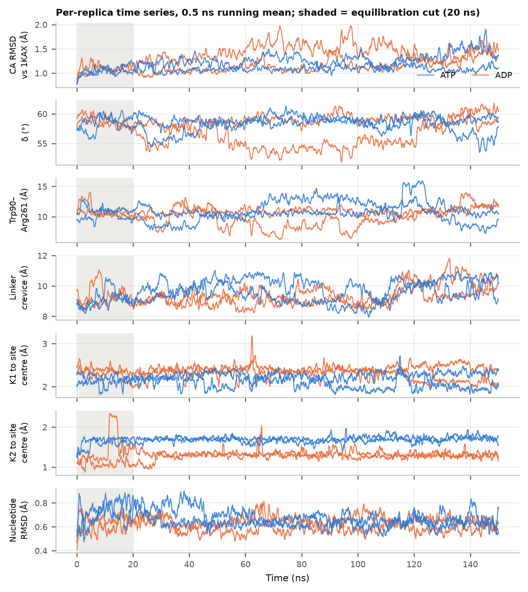

# Hsc70 NBD Allosteric Molecular Dynamics Pipeline (GROMACS + OpenMM)

Reproducible all-atom molecular dynamics (MD), lobe-rotation kinematics, interdomain linker docking, and optional NMR chemical-shift-perturbation (CSP) comparison pipeline investigating nucleotide-dependent allostery in the human/bovine **Hsc70 (HSPA8) nucleotide-binding domain (NBD)**.

## Scientific Question & Experimental Design

In Hsp70 chaperones, ATP binding drives an allosteric transition in which NBD lobes I and II rotate relative to one another to open the IA/IIA interdomain linker-binding slot and dock the substrate-binding domain (SBD). This pipeline tests whether ATP versus ADP alone induces long-range conformational shifts at NBD docking interfaces, and quantifies the role of the docked interdomain linker across three paired GROMACS simulation setups:

1. **Isolated NBD (`4–381`)**: Paired ATP vs ADP runs started from crystal structure `1KAX` (with `M71K` reverted to wild-type; ADP generated by deleting the $\gamma$-phosphate and placing an octahedral-shell water at the vacated `O3G` position, matching 4/5 ADP-only Hsc70 crystal structures). Completed: `2 × 150 ns` per state (`600 ns` total).
2. **NBD + Interdomain Linker (`4–395`)**: Hybrid model (`scripts/build_linker_model.py`) placing Hsc70 lobes I and II onto the linker-docked DnaK ATP structure `7RAX` (`+11.6°` lobe rotation), threading residues `G382` and `V388–D395` (`VQDLLLLD`), building the Hsc70-specific `383–387` insertion via `PDBFixer`, and relaxing junctions in OpenMM (`amber14` + `GBn2`). Completed: `2 × 100 ns` per state (`400 ns` total).
3. **Linker-Stripped Rotated Control (`4–381` from `+12°`)**: Same pre-rotated coordinates with residues `382–395` removed (`work_nl_atp`, `work_nl_adp`), designed to disambiguate linker-stabilised lobe rotation from slow elastic relaxation back toward `0°`.

### Force-Field & Active-Site Fidelity

- **Protein, solvent & ions**: `AMBER ff19SB` + 4-point `OPC` water + Li–Merz 12-6 OPC parameters (`0.15 M KCl`, preventing $\mathrm{Na^+}$ competition at active-site $\mathrm{K^+}$ pockets).
- **Nucleotides & bound cofactors**: Meagher *et al.* (2003) polyphosphate parameters with RESP charges (`params/ATP.prep`, `params/ADP.prep`, `params/frcmod.phos`), retaining crystal $\mathrm{Mg^{2+}}$, active-site `K1`/`K2`, and first-shell crystal waters as position-restrained molecule types (`CWAT`).
- **Cation-aware protonation**: `PROPKA3` at pH `7.0` with automatic re-deprotonation of cation-coordinating carboxylates (`Asp10`, `Asp199`, `Asp206`) within `4.0 Å` of bound $\mathrm{Mg^{2+}}$/$\mathrm{K^+}$ (verified against metal-included `PROPKA3` calculations).
- **Sampling protocol**: Steepest-descent EM -> `100 ps` restrained NVT (`v-rescale`, `300 K`) -> `1 ns` restrained NPT (`c-rescale`, `1 bar`) -> `4 fs` HMR production (`mass-repartition-factor = 3`, `lincs-order = 6`, `lincs-iter = 2`).

Detailed study design and literature justification are documented in [`docs/ANALYSIS_PLAN.md`](docs/ANALYSIS_PLAN.md) and [`docs/METHODS_RATIONALE.md`](docs/METHODS_RATIONALE.md).

## Key QC & Quantitative Summary (Completed Runs)

Across all four `150 ns` isolated-NBD replicas (`results/summary/qc.csv`), active-site cofactor integrity was **100% maintained** (`mg_expected_coord = 1.00`, `k1_in_site = 1.00`, `k2_in_site = 1.00`), backbone $\mathrm{C\alpha}$ RMSD stayed between `1.09–1.43 Å`, nucleotide RMSD remained `0.59–0.67 Å`, and minimum periodic-image distance exceeded `17.8 Å`:

| System & State | Replicas | Analysis Window | Lobe Rotation along Docked Axis (°) | Linker Contacts Kept ($Q$) |
| :--- | :--- | :--- | :--- | :--- |
| Isolated NBD · ATP (`atp`) | `2 × 150 ns` | `20–150 ns` | `-3.26 ± 2.28`, `-1.40 ± 1.84` | — |
| Isolated NBD · ADP (`adp`) | `2 × 150 ns` | `20–150 ns` | `+0.15 ± 2.00`, `-2.78 ± 2.93` | — |
| NBD + Linker · ATP (`lk_atp`) | `2 × 100 ns` | `80–100 ns` | `+6.11 ± 1.33`, `+5.60 ± 1.67` | `0.73`, `0.62` (0 releases) |
| NBD + Linker · ADP (`lk_adp`) | `2 × 100 ns` | `80–100 ns` | `+1.46 ± 1.86`, `+7.65 ± 1.82` | `0.76`, `0.83` (0 releases) |



Summary finding: isolated Hsc70 NBD remains near the closed `1KAX` geometry (`-3.3°` to `+0.2°`) in both ATP and ADP states over `150 ns` without spontaneous opening toward the `+11.6°` (`7RAX`) or `+23°` (`4B9Q`) docked states, while distance-matched null tests (`results/summary/interfaces.csv`) control for the radial $\gamma$-phosphate distance confounder.

## Repository Layout

```text
.
├── docs/
│   ├── ANALYSIS_PLAN.md           # Hypotheses H1–H4, 4B9Q interface definitions & statistical criteria
│   └── METHODS_RATIONALE.md       # Force-field, ion, protonation & sampling evidence table (with PMIDs/DOIs)
├── mdp/
│   ├── ions.mdp                   # GROMACS ion-addition parameters
│   ├── em.mdp                     # Steepest-descent energy minimisation
│   ├── nvt.mdp                    # 100 ps restrained NVT equilibration (2 fs, HMR)
│   ├── npt.mdp                    # 1 ns restrained NPT equilibration (2 fs, HMR)
│   └── prod.mdp                   # Unrestrained NPT production (4 fs HMR, LINCS order 6 / iter 2)
├── params/
│   ├── ATP.prep                   # Meagher et al. (2003) ATP polyphosphate parameters
│   ├── ADP.prep                   # Meagher et al. (2003) ADP polyphosphate parameters
│   └── frcmod.phos                # Polyphosphate force-field modifications
├── results/
│   ├── fig_md_qc.png              # 300-DPI per-replica QC time series (150 ns isolated NBD)
│   └── summary/                   # Aggregated QC, H1–H3 scalar stats, interface null & rotation CSVs
├── scripts/
│   ├── fetch_structures.py        # Downloads public RCSB PDB structures (1KAX, 3HSC, 1YUW, DnaK set)
│   ├── prep_1kax.py               # Splits starting PDB into protein, ATP/ADP, Mg2+/2K+ & OPC crystal waters
│   ├── build_linker_model.py      # Builds 7RAX-templated Hsc70 NBD+linker model + OpenMM GBn2 relaxation
│   ├── build_system.sh            # Self-contained GROMACS builder (ff19SB + OPC + Meagher + PROPKA + EM)
│   ├── run_md.sh                  # Self-contained NVT -> NPT -> checkpoint-resumable production runner
│   ├── nbd_defs.py                # Shared subdomains, 4B9Q interfaces, K+ sites & Kabsch geometry helpers
│   ├── lobe_rotation.py           # BLOSUM62-aligned lobe II vs lobe I axis-angle rotation projection
│   ├── an_prep.sh                 # Whole-molecule PBC centering & top.pdb extraction
│   ├── an_rep.py                  # Per-frame geometric, ion-site, P-loop & PBC minimum-image observables
│   ├── an_linker.py               # Linker contact retention Q, slot-aligned RMSD & leucine burial
│   ├── an_rotation.py             # Unified lobe-rotation projection across all simulated conditions
│   ├── an_snap.py                 # Full-system checkpoint snapshot Mg2+/K+ hydration & site-3 QC
│   ├── snap_sampler.sh            # Background full-system checkpoint snapshot sampler
│   ├── an_compare.py              # Multi-replica QC, H1–H4 stats, distance-matched null & optional CSP check
│   ├── an_figures.py              # Publication-grade H1–H4 composite figure, QC plot & PyMOL mapping script
│   ├── fig_rotation.py            # Multi-system lobe-rotation & linker-contact figure generator
│   ├── an_movie.py                # Generates interactive side-by-side 3Dmol.js HTML trajectory viewer
│   ├── movie_template.html        # Interactive 3Dmol.js & SVG time-series viewer template
│   └── run_analysis.sh            # End-to-end analysis pipeline entrypoint
├── tests/
│   └── test_hsc70_pipeline.py     # Unit & static validation tests
├── environment.yml
├── LICENSE
└── README.md
```

## Installation & Usage

### 1. Environment & Public Crystal Structures

```bash
mamba env create -f environment.yml
mamba activate hsc70-md
python scripts/fetch_structures.py
```

### 2. Build Systems & Run Production MD

```bash
# Isolated NBD (ATP and ADP paired from 1KAX)
bash scripts/build_system.sh atp
bash scripts/build_system.sh adp
bash scripts/run_md.sh atp --replicas 2 --ns 150
bash scripts/run_md.sh adp --replicas 2 --ns 150

# NBD + interdomain linker (7RAX-templated model)
python scripts/build_linker_model.py structures/hsc70_nbd_linker.pdb --relax-ps 200
PDB=structures/hsc70_nbd_linker.pdb NAME=lk_atp bash scripts/build_system.sh atp
PDB=structures/hsc70_nbd_linker.pdb NAME=lk_adp bash scripts/build_system.sh adp
bash scripts/run_md.sh lk_atp --replicas 2 --ns 100
bash scripts/run_md.sh lk_adp --replicas 2 --ns 100
```

### 3. Run Analysis, Figures & Interactive 3D Viewer

```bash
# Isolated NBD analysis & composite figures (optional: --csp path/to/csp.tsv)
bash scripts/run_analysis.sh --skip 20 --reps 1,2

# Linker docking & multi-system lobe-rotation figure
python scripts/an_linker.py --summary
python scripts/an_rotation.py
python scripts/fig_rotation.py

# Interactive side-by-side ATP vs ADP 3Dmol.js browser viewer
python scripts/an_movie.py --rep 1 --block 1.0
```

## Testing

```bash
python3 -m unittest discover -s tests -v
```

## References & Attribution

- **Crystal structures**: `1KAX` (O'Brien *et al.*, 1996, *J. Biol. Chem.* 271:15874), `3HSC` (Flaherty *et al.*, 1990, *Nature* 346:623), `7RAX` (Wang *et al.*, 2021), and DnaK docked ensemble (`4B9Q`, `4JNE`, `7KRT`, `7KO2`, `5NRO`).
- **Active-site ion coordination**: Wilbanks & McKay (1995), *J. Biol. Chem.* 270:2251.
- **Polyphosphate parameters (`params/`)**: Meagher, Redman & Carlson (2003), *J. Comput. Chem.* 24:1016.
- **OPC ions & HMR**: Li *et al.* (2020), *J. Chem. Theory Comput.* 16:4429; Sengupta *et al.* (2021); Hopkins *et al.* (2015), *J. Chem. Theory Comput.* 11:1864.
- **Allosteric literature context**: Woo *et al.* (2009), *Biochemistry* 48:11470; Zhuravleva *et al.* (2012), *Cell* 151:1296; Gołaś *et al.* (2015), *Proteins* 83:282.

## Licence

Pipeline scripts, MDP templates, and documentation are released under the [MIT License](LICENSE). Third-party polyphosphate parameter files in `params/` (Meagher *et al.*, 2003) retain their original academic attribution.
